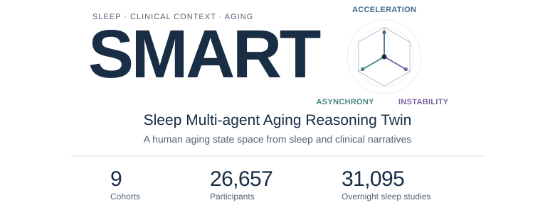
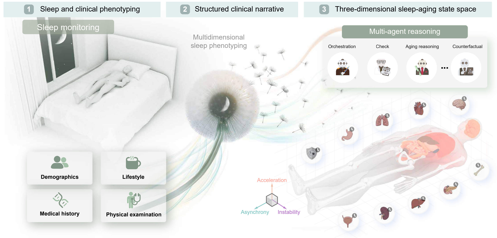
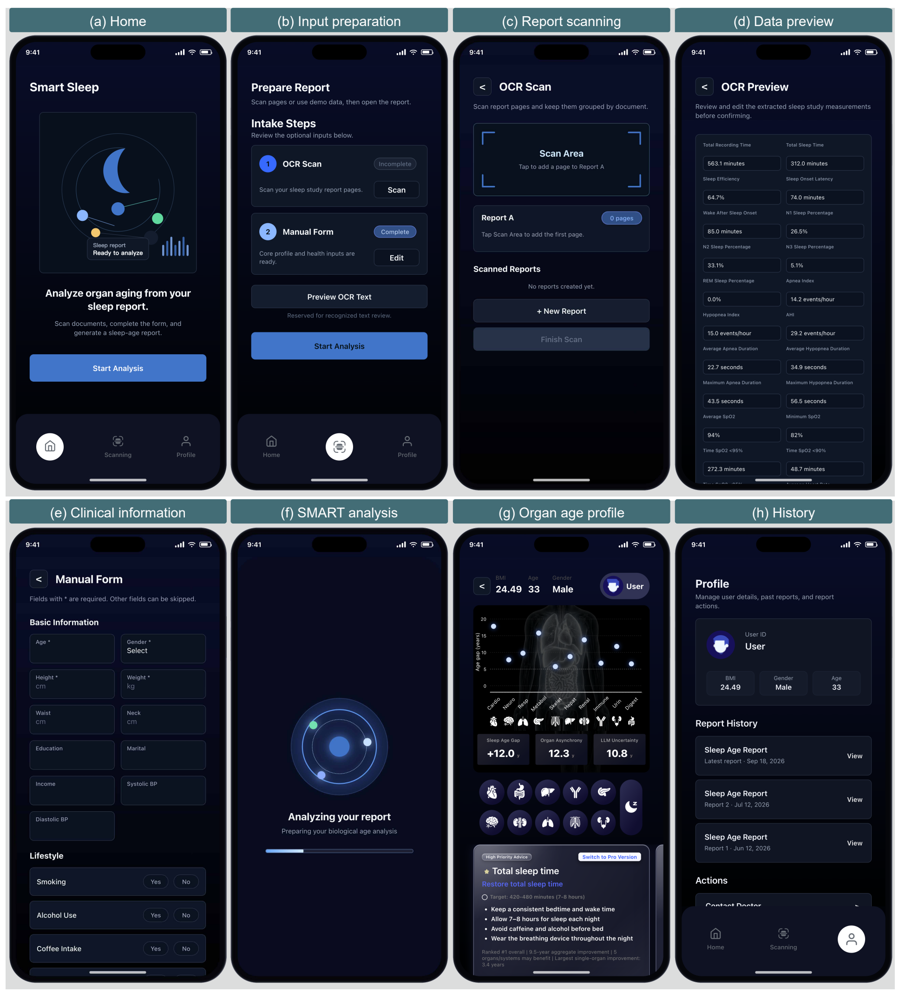

<div align="center">



**Single-night sleep and clinical phenotypes reveal a human aging state space**

[Framework](#the-smart-framework) · [Examples](#explore-three-clinical-inputs) · [Prompts](#two-task-prompts) · [Quick start](#quick-start) · [Mobile prototype](#mobile-prototype)

</div>

**SMART** interprets sleep measurements in individual clinical context to estimate overall sleep age and organ-specific ages. Repeated stochastic decoding characterizes **age acceleration, organ asynchrony and decoding instability**. Counterfactual changes to clinical narratives explore organ age responses and inform recommendations for clinician review.



## The SMART framework

| Age acceleration | Organ asynchrony | Decoding instability |
| :--- | :--- | :--- |
| How far does predicted age differ from chronological age? | How unevenly do the organ age gaps differ within an individual? | How much do estimates for the same organ vary across repeated decodings? |
| Mean predicted age − chronological age | Sample SD across organ age gaps | Mean within-organ decoding SD |

The framework organizes report structuring, age estimation and recommendation generation with corresponding checks. The released implementation provides the **two generation prompts**, structured-input tools, aging-state calculations, linked-field counterfactual utilities and paired-bootstrap evaluation. The principal study backbone is **Llama-3.3-70B-Instruct**. Output domains are configurable, comprising overall sleep age and up to ten organ ages.

## Explore three clinical inputs

Three **constructed examples** cover respiratory burden, sleep continuity and limited measurement coverage. They contain no participant records. The walkthrough renders each SCN, prepares the age-estimation prompt and shows linked changes to counterfactual inputs.

| Example | Selected recorded information | What to explore |
| :--- | :--- | :--- |
| [Respiratory burden and clinical context](examples/01_respiratory_context.json) | AHI 36 events/h, T90 10%, BMI 30.0 kg/m², hypertension history | Interpretation of respiratory measurements alongside clinical context, with an AHI scenario that updates component indices |
| [Sleep continuity and architecture](examples/02_sleep_continuity.json) | AHI 2.4 events/h, TST 300 min, efficiency 71.43%, arousal index 22 events/h | Information beyond respiratory-event frequency, with a TST scenario that updates efficiency |
| [A limited measurement set](examples/03_limited_measurements.json) | Home-monitoring REI 14.25 events/h of recording time, ODI (3%) 12 events/h, sleep staging not recorded | Shared narrative structure across different measurement sets, preserving unknown values and the REI/AHI distinction |

**[Open the walkthrough notebook →](examples/SMART_walkthrough.ipynb)**

The examples use common sleep measurements, demographics and clinical history. Recorded negatives remain distinct from unknown histories.

## Two task prompts

| Task | Input | Output |
| :--- | :--- | :--- |
| **[Age estimation](smart/templates/age_estimation.txt)** | SCN + requested age domains | Numerical ages and accompanying generated explanations |
| **[Recommendation generation](smart/templates/recommendation.txt)** | SCN + labelled baseline/counterfactual age table | Clinical summary, prioritized recommendations and a follow-up plan |

The templates preserve the selected manuscript prompt text. Ten stochastic decodings use temperature **0.7** and top-p **0.9**. Paired counterfactual age estimates use the same greedy settings for baseline and modified inputs. Model generation is outside this release. Analyses accept saved age estimates.

## Quick start

Python 3.11 or later. From the repository root:

```bash
python -m pip install -e ".[analysis,dev]"
python examples/run_demo.py
python -m pytest -q
```

The walkthrough creates SCNs, task prompts and a field-change table in `outputs/walkthrough/`. Load saved age estimates to calculate age gaps, organ asynchrony and decoding instability, as described in [Using saved predictions](REPRODUCIBILITY.md#using-saved-predictions).

## Reproduce the decoding comparison

The repository includes the **complete released summary tables** for Fig. 4h (ten organ-group AUC comparisons) and Extended Data Fig. 9c (eight cardiovascular C-index comparisons), each with three decoding strategies and 95% CIs from 2,000 paired participant bootstrap resamples.

```bash
python analyses/replot.py
```

This redraws every supplied estimate and CI. For recomputation from aligned participant scores, use [analyses/evaluate.py](analyses/evaluate.py). The stochastic single-decoding strategy averages **ten performance estimates**. The ensemble strategy evaluates **participant-level mean predictions**. [Analysis definitions →](REPRODUCIBILITY.md#decoding-comparisons)

## Mobile prototype



The mobile prototype brings clinical input, aging profiles and report history into one interface. Recommendations are intended for clinician review. This repository releases the research toolkit and interface artwork. Application code and an autonomous six-agent service are outside this release.

## Reproducibility and access

[REPRODUCIBILITY.md](REPRODUCIBILITY.md) records definitions, input requirements, release coverage, source provenance and validation. Restricted cohort records and participant predictions are obtained through the applicable data-access process. Public-cohort access is described by the [National Sleep Research Resource](https://sleepdata.org/). The supplied SCNs are constructed, while the two aggregate result tables are study-derived.

## Citation

Hu, S. and colleagues. *Single-night sleep and clinical phenotypes reveal a human aging state space*. Manuscript. Repository metadata: [CITATION.cff](CITATION.cff).

Code, prompts and constructed examples: [MIT License](LICENSE). Manuscript artwork and third-party marks retain their respective rights, detailed in [REPRODUCIBILITY.md](REPRODUCIBILITY.md#prompts-and-artwork).
